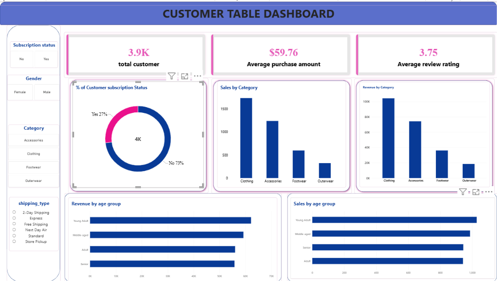

# Customer Shopping Behavior Analysis

An end-to-end data analytics project that explores customer shopping behavior using **Python**, **PostgreSQL** and **Power BI**. The goal is to uncover spending patterns, customer segments, product preferences and subscription behavior to support strategic business decisions.

## Project Overview

The project analyzes **3,900 purchase transactions** across multiple product categories. It follows a complete analytics workflow:

1. **Python**: data loading, cleaning and feature engineering
2. **PostgreSQL**: 10 business questions answered with SQL
3. **Power BI**: an interactive dashboard to present the insights

## Dataset

- **Rows:** 3,900
- **Columns:** 18
- **Customer demographics:** Age, Gender, Location, Subscription Status
- **Purchase details:** Item Purchased, Category, Purchase Amount, Season, Size, Color
- **Shopping behavior:** Discount Applied, Promo Code Used, Previous Purchases, Frequency of Purchases, Review Rating, Shipping Type
- **Missing data:** 37 values in the Review Rating column

## Tools and Technologies

| Area | Tools |
|------|-------|
| Data preparation | Python, pandas |
| Database | PostgreSQL |
| Query language | SQL (CTEs, window functions, CASE, aggregations) |
| Visualization | Power BI |

## Data Preparation (Python)

- Loaded the dataset with `pandas` and explored it using `df.info()` and `describe()`
- Imputed missing Review Ratings using the median rating of each product category
- Renamed columns to snake_case
- Created new features: `age_group` and `purchase_frequency_days`
- Dropped `promo_code_used` because it was redundant with `discount_applied`
- Loaded the cleaned DataFrame into PostgreSQL for SQL analysis

## SQL Analysis: Business Questions

1. What is the total revenue generated by male vs. female customers?
2. Which customers received a discount but still spent above the average purchase amount?
3. Which are the top 5 products with the highest average review rating?
4. How does the average purchase amount compare between Standard and Express shipping?
5. Do subscribed customers spend more than non-subscribed customers?
6. Which 5 products have the highest percentage of purchases with a discount applied?
7. How can customers be segmented into New, Returning and Loyal?
8. What are the top 3 most purchased products within each category?
9. Are repeat buyers (more than 5 previous purchases) also likely to subscribe?
10. What is the revenue contribution of each age group?

All queries are available in [`customer_behavior_sql_queries.sql`](customer_behavior_sql_queries.sql).

## Key Insights

- **Gender:** Male customers generate about 68% of revenue ($157,890 vs $75,191 for female customers).
- **Discounts:** 839 customers used a discount and still spent above the average purchase amount of $59.76.
- **Ratings:** Gloves (3.86), Sandals (3.84) and Boots (3.82) are the highest-rated products.
- **Shipping:** Express shipping customers spend more per purchase ($60.48 vs $58.46 for Standard).
- **Subscriptions:** Only 27% of customers are subscribed, and their average spend ($59.49) is similar to non-subscribers ($59.87).
- **Discount dependence:** Hat (50.00%), Sneakers (49.66%) and Coat (49.07%) have the highest share of discounted purchases.
- **Segments:** About 80% of customers are Loyal (3,116), 18% Returning (701) and 2% New (83).
- **Repeat buyers:** 2,518 of 3,476 repeat buyers are not subscribed.
- **Age groups:** Young Adults contribute the most revenue ($62,143), but all four age groups are close.

## Power BI Dashboard

The interactive dashboard (`customer_behavior.pbix`) includes:

- KPI cards: 3.9K customers, $59.76 average purchase amount, 3.75 average review rating
- Customer subscription status split (27% Yes, 73% No)
- Sales and revenue by category
- Sales and revenue by age group
- Filters for subscription status, gender, category and shipping type



## Business Recommendations

- **Boost subscriptions:** promote exclusive benefits for subscribers
- **Customer loyalty programs:** reward repeat buyers to move them into the Loyal segment
- **Review discount policy:** balance sales boosts with margin control
- **Product positioning:** highlight top-rated and best-selling products in campaigns
- **Targeted marketing:** focus on high-revenue age groups and express-shipping users

## Repository Contents

| File | Description |
|------|-------------|
| `customer_shopping_behavior.csv` | Dataset used for the analysis |
| `customer_behavior_sql_queries.sql` | 10 PostgreSQL business queries |
| `customer_behavior.pbix` | Power BI dashboard file |
| `Customer_Behavior_PowerBI.SS.png` | Dashboard screenshot |
| Project report and presentation | Full write-up of the analysis and slides |
| `README.md` | Project documentation |

## How to Run

1. Clone the repository
   ```bash
   git clone https://github.com/Piyushjha1806/customer-shopping-behavior-analysis.git
   ```
2. Use the Python script or notebook to clean the data and load it into PostgreSQL.
3. Run the queries in `customer_behavior_sql_queries.sql` against the `public.customer` table.
4. Open `customer_behavior.pbix` in Power BI Desktop to explore the dashboard.

## Author

**Piyush Jha**
Data Analyst | Power BI | Tableau | SQL | Excel
GitHub: [Piyushjha1806](https://github.com/Piyushjha1806)
